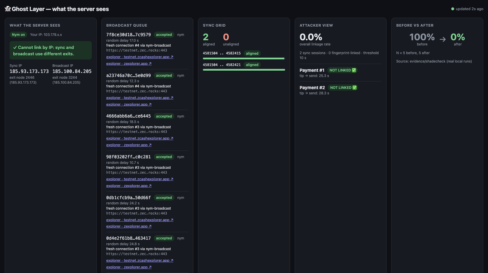
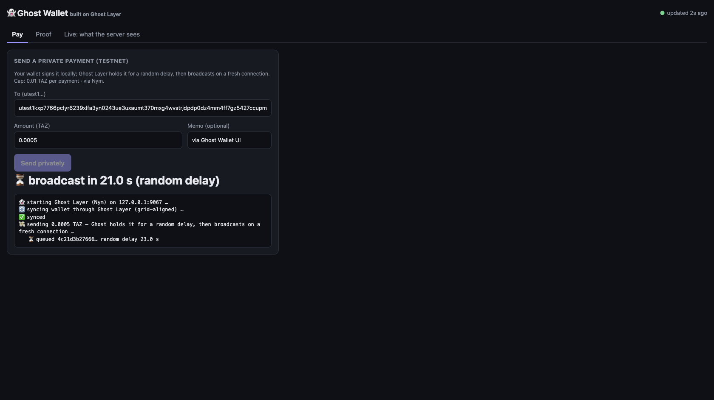
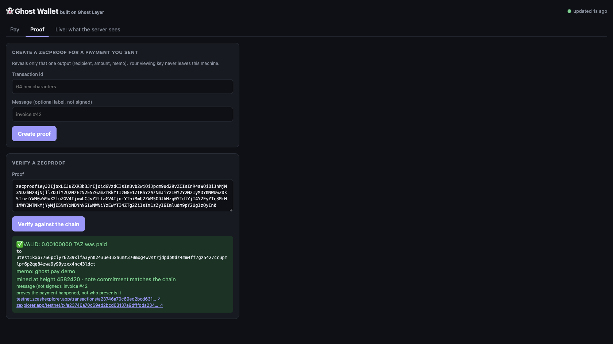

# 👻 Ghost Layer

[crates.io: `ghost-layer`](https://crates.io/crates/ghost-layer) · `ghost-layer-core` · `ghost-layer-transport` · `ghost-layer-gateway` · `ghost-layer-attacker`

**Everyone hid your IP. Nobody stopped your payment from being linked to you. Ghost Layer does, and an independent tool and our own attacker test measure it.**

Built for Free Society Hack, Mumbai (Privacy track, Zcash), 4 Nov 2026. Zcash **testnet**, NU7 (branch `0x77190AD9`), Ironwood pool.

## 30-second version

Zcash hides the money. It doesn't hide the *person*. Your wallet talks to a light-wallet server to **sync** (check for new mail) and to **broadcast** (drop off the envelope). The server can't open the envelope, but it writes down:

| What the server notes | Why it hurts |
|---|---|
| 🧑 your **IP** | where you are |
| 🕐 **timing**: you sync, then send seconds later | links *this* payment to *this* wallet ("sync-then-send") |
| 📚 your **block ranges**: today's start = yesterday's end + 1 | chains all your sessions into one history |

Ghost Layer is a small local gateway between any lightwalletd-compatible wallet and the server. **The wallet doesn't change:** point it at `127.0.0.1:9067`.

| # | What Ghost Layer does | Leak it closes |
|---|---|---|
| 1 | **Split broadcast:** every `SendTransaction` goes out on a **brand-new connection** (new TCP/SOCKS + TLS + HTTP/2), never the sync connection; with Nym, through a **different exit** | payment ↔ sync link |
| 2 | **Randomized broadcast scheduling:** each tx waits a random delay (demo 10–40 s, privacy 60–600 s), never right after reaching the tip; queued in sqlite and restart-safe | 🕐 timing |
| 3 | **Grid-aligned sync:** upstream only ever sees whole 1152-block grid cells, using **Nym's network-wide `nym-swizzle-zcash` rule**; the wallet still gets exactly what it asked for | 📚 range fingerprint |
| 4 | **Nym mixnet transport, on by default:** two `nym-socks5-client`s with different random exits, sync on one and broadcast on the other, **fail closed** (`--direct` opts out) | 🧑 IP |

## Why this is needed (sources)

- **The leak is real and measured by an independent tester.** ShadeCheck's README reports that an *unmodified Zingolib 7.0.0* wallet on Zebra 7.0.0 / Zaino 0.10.1 "sent a shielded payment … The separate test recorded 1,009 events and **two HIGH SC-002 findings**" ([ShadeCheck README](https://github.com/0xaje/ShadeCheck-)).
- **Hiding the IP doesn't fix it.** Nym's `nym-swizzle-zcash` README on resume-point chaining and sync-then-send: "Both leaks survive any mixnet, VPN, or Tor circuit, because they live in the application's query pattern" ([nym-swizzle-zcash](https://github.com/nymtech/nym/tree/develop/sdk/rust/nym-swizzle-zcash)).
- **Nobody had shipped the fix.** zecmix's README lists as *future plans*: "`--split` mode: send `SendTransaction` over a separate connection and identity from the sync session, so the server cannot link a broadcast to the wallet that synced" and "Optional random delay before broadcast" ([zecmix, Future plans](https://github.com/apeirs/zecmix#future-plans)). Ghost Layer ships both, plus Nym's grid rule, and measures the result.

## Evidence (real, committed, reproducible)

| What | Result | File |
|---|---|---|
| Attacker linkage test, 5 real payments each, local regtest | **100 % → 0 %** linked (sync-then-send ≤ 10 s: 5/5 → 0/5; range chaining 4/5 → 0/5 sessions; median tip→broadcast 3.0 s → 22.4 s). Same-IP is still 5/5 locally (one machine), and only Nym fixes that | [`evidence/ATTACK_RESULTS.md`](evidence/ATTACK_RESULTS.md) |
| Re-run by `scripts/e2e_local.sh`, 10 more payments | 5/5 → 0/5, 0 unaligned upstream ranges | [`evidence/runs/`](evidence/runs/) |
| ShadeCheck (independent tester, strict) before/after | SC-001: alignment violations removed (size still flagged: tip-capped cell). SC-002: MEDIUM in both, because this ShadeCheck version flags every broadcast. **Reported as is, see the interpretation** | [`evidence/BEFORE_AFTER.md`](evidence/BEFORE_AFTER.md) |
| Grid alignment on **public testnet** | 5/5 upstream ranges aligned; two wallets synced to 100 % | [`evidence/grid_alignment.md`](evidence/grid_alignment.md) |
| Nym on **public testnet** | server sees sync exit `195.238.126.176` ≠ broadcast exit `157.254.54.45` ≠ your IP; wallet synced through the mixnet; killing a Nym client → `UNAVAILABLE`, never a direct fallback | [`evidence/logs/step5_ghost_ip.txt`](evidence/logs/step5_ghost_ip.txt), [`step5_fail_closed.txt`](evidence/logs/step5_fail_closed.txt) |
| Broadcast pipeline over Nym on **public testnet** | fresh connection #3 via the Nym broadcast exit after a 14.7 s random delay. (This was a re-submitted mined tx, rejected as a duplicate. Not a payment.) | [`evidence/nym_broadcast_pipeline.md`](evidence/nym_broadcast_pipeline.md) |
| **Nym on testnet, N = 5** (+1 e2e) | 5 real payments via `ghost up`, fresh random exits per run: **0 / 5 linked** by connection, timing (16–35 s after tip), IP (sync exit ≠ broadcast exit) or range chaining | [`evidence/ATTACK_RESULTS.md`](evidence/ATTACK_RESULTS.md) (Nym column + per-payment table) |
| `ghost pay` (one command) | real payment with memo; receiver's viewing key decrypts amount **and memo**; `--json` output validated by `cargo test` | [`evidence/pay_demo.md`](evidence/pay_demo.md) |
| Queue mode + restart-resume | `--send-mode queue`: wallet returns in 3.6 s, `ghost status` tracks the real outcome; killed with a tx queued → restart gives a **fresh** random delay, sent **exactly once**, mined | [`evidence/p2/README.md`](evidence/p2/README.md) |
| `ghost verify --ufvk` | read-only decryption of Ironwood outputs with a viewing key (incoming / outgoing / change; negative control) | [`evidence/ufvk_verify.md`](evidence/ufvk_verify.md) |
| **ZecProof** | a real proof for our `ghost pay` payment verifies (0.001 TAZ, memo, height); tampered OCK, other tx/action, mainnet claim and receiver's key are all rejected | [`evidence/zecproof.md`](evidence/zecproof.md) |
| MCP server | a real MCP client (Claude Code) calls `ghost_status` + `ghost_verify` and answers from real data; `ghost_pay` caps refuse over-limit/mainnet | [`evidence/mcp_demo.md`](evidence/mcp_demo.md) |
| **Real testnet payments** | before (direct): [`4d8f96ec…126b4970`](https://testnet.zcashexplorer.app/transactions/4d8f96ec56cd36871d6611e8fbe72cfc37cd7e9730d32cafeb2992fa126b4970), mined at 4582106 · **after (Ghost Layer + Nym)**: [`09f0f0b0…2bd3ce69`](https://testnet.zcashexplorer.app/transactions/09f0f0b01942a658197f65563a977c66fc19f8823268b0e547470e022bd3ce69), mined at 4582118: sync via one Nym exit, broadcast on a fresh connection via another after a 16.3 s random delay | [`evidence/testnet_tx.md`](evidence/testnet_tx.md) |

## Quickstart: three commands

```bash
# 1. install: prebuilt ghost + zcash-devtool, SHA-256 checked (macOS arm64/x86_64, Linux x86_64; from v0.2.0)
curl -fsSL https://github.com/skartik-sk/ghost-layer/releases/latest/download/install.sh | sh
#    or from source: cargo install --locked ghost-layer   (needs Rust ≥ 1.85 + protoc)

# 2. one-time setup: creates a testnet wallet THROUGH Ghost + Nym and makes it the default
ghost init                       # prints your address and a faucet command

# 3. pay privately: starts Nym (built in) and the gateway, syncs grid-aligned, holds the tx for a
#    random delay, broadcasts on a fresh connection via a different Nym exit, waits until mined
ghost pay --to utest1… --amount 0.001
```

Nym runs **inside `ghost`** (nym-sdk): no separate client to build. Exits are tested with a real request before use
and replaced automatically when they stop carrying traffic; if no working exit is available, Ghost refuses to send
rather than leak your IP. `ghost nym` keeps the two clients up for other wallets; `scripts/nym_setup.sh` still works
with an external `nym-socks5-client`.

**Tor fallback for broadcasts.** If a Tor SOCKS port is running (`brew install tor && tor`, `arti proxy`, or Tor
Browser with `--tor 127.0.0.1:9150`), a broadcast that can't get through Nym goes out over Tor on a new circuit
instead, never directly. Sync stays on Nym, so sync and broadcast leave through two different anonymity networks.
`--no-tor` turns it off. Real runs: [`evidence/v0.2/`](evidence/v0.2/README.md).

Watch it live: `target/release/ghost dashboard` → <http://127.0.0.1:9070> (what the server sees, queue countdowns, grid, attacker view). Real data from our testnet runs:



<details><summary>Manual mode (any wallet that accepts a custom server)</summary>

```bash
target/release/ghost doctor
target/release/ghost up [--profile demo|privacy] [--send-mode hold|queue]
zcash-devtool wallet -w ./w sync -s 127.0.0.1:9067
zcash-devtool wallet -w ./w send -i ./w.age --address <utest1…> --value 100000 -s 127.0.0.1:9067
target/release/ghost status            # random delay, fresh connection id, transport, explorer links
target/release/ghost ip          # which IP the server sees on each path (real measurement)
target/release/ghost verify <txid>
```
</details>

All commands accept `--json`. Exit codes: `0` ok, `1` runtime failure (or "not mined yet" for `verify`), `2` usage/config error, `3` transaction rejected. Output shapes: [docs/json-schema.md](docs/json-schema.md). Every error prints a "→ what to do next" hint.

| Command | Purpose |
|---|---|
| `ghost init` | first run: testnet wallet created through Ghost + Nym; saved as the default for pay / dashboard / mcp |
| `ghost pay` | one-command private payment: gateway → sync → send (random delay, fresh connection) → mined → explorer links |
| `ghost proof create / verify` | **ZecProof**: prove ONE payment you sent (`zecproof1…`), revealing only that output; anyone can verify it against the chain |
| `ghost dashboard` | **Ghost Wallet** on `127.0.0.1:9070` (loopback only): Pay · Proof · Live (what the server sees). Uses the `ghost init` wallet (or `--wallet --identity --ufvk-file`) |
| `ghost nym` | run the built-in Nym clients (sync `:1080`, broadcast `:1081`, different exits, self-healing) until Ctrl-C |
| `ghost mcp` | MCP server (stdio) for AI agents: read-only tools; `ghost_pay` only with `--allow-pay` + caps |
| `ghost up` | gateway on `127.0.0.1:9067` (loopback only unless `--allow-remote`); `--broadcast-server` to broadcast via a different server than you sync from |
| `ghost doctor` | upstream reachable, chain = test, NU branch id, tip, TLS, port, storage; both Nym clients + exit IPs, upstream **only via Nym** (default) |
| `ghost status` | broadcast queue: pending/accepted/rejected/failed, delay, fresh connection, explorer links |
| `ghost verify <txid>` | mined? height, confirmations, explorer links (asked through the Nym broadcast exit by default; `--ufvk-file` decrypts with a viewing key) |
| `ghost ip` | IP the server sees on SYNC vs BROADCAST (your own IP masked by default) |
| `ghost explain` | plain-language explanation of the three leaks and what is closed |
| `ghost attack --events f` | linkage heuristics over a server-side observer log |
| `ghost report --before d --after d` / `--attack` | `BEFORE_AFTER.md` / `ATTACK_RESULTS.md` |

## Ghost Wallet: an app built on Ghost Layer

`ghost dashboard --wallet ./w --identity ./w.age --ufvk-file sender.ufvk` → open the printed `http://127.0.0.1:9070/?t=…` URL (the per-run token authorises Pay/Proof): **Pay** (live random-delay countdown → mined), **Proof** (create / verify ZecProofs), **Live** (what the server sees). It is **339 lines of Rust + 557 lines of HTML** on top of the Ghost Layer crates (`ghost-core` queue, `ghost-attacker`, `ghost-transport`), and Pay/Proof run the exact `ghost pay` / `ghost proof` code paths. A real payment and proof made through the UI: [`evidence/app/`](evidence/app/README.md).

| Pay (live countdown) | Proof (verified) |
|---|---|
|  |  |

## Verify our payments yourself (viewing key)

The demo **receiving** wallet's viewing key (testnet only; it can decrypt, never spend) is in [`evidence/ufvk_verify.md`](evidence/ufvk_verify.md):

```bash
target/release/ghost verify --ufvk-file <(sed -n '/^uviewtest1/p' evidence/ufvk_verify.md) 09f0f0b01942a658197f65563a977c66fc19f8823268b0e547470e022bd3ce69
# ✅ mined at height 4582118 … 🔑 ironwood incoming — 0.00100000 TAZ (100000 zat)
```

## For AI agents

- [`llms.txt`](llms.txt) / [`llms-full.txt`](llms-full.txt): what Ghost Layer is, every command, JSON shapes, and the NU7/Ironwood/testnet facts
- [`AGENTS.md`](AGENTS.md) / [`CLAUDE.md`](CLAUDE.md): how a coding agent builds, tests and runs this repo (and its rules)
- [`docs/json-schema.md`](docs/json-schema.md) + [`docs/schemas/`](docs/schemas/): stable `--json` contract (`schema_version` 1), validated against real output by `cargo test`
- [`skills/ghost-layer/SKILL.md`](skills/ghost-layer/SKILL.md): agent skill (when to use, steps, safety rules, reading results)
- **MCP server**: `ghost mcp` (stdio, official `rmcp` 3.8.0 SDK). Tools: `ghost_status`, `ghost_verify`, `ghost_ip`, `ghost_doctor`, `ghost_report`, `ghost_explain` (read-only). `ghost_pay` exists only when *you* start it with `--allow-pay --max-amount <TAZ> --max-per-hour <n> --wallet <dir> --identity <file>`; caps are enforced in code, testnet-only, every call is logged to `~/.ghost-layer/mcp-calls.jsonl`. Real client transcript: [`evidence/mcp_demo.md`](evidence/mcp_demo.md).

```json
{
  "mcpServers": {
    "ghost-layer": { "command": "/path/to/ghost-layer/target/release/ghost", "args": ["mcp"] }
  }
}
```

Then ask your agent: *"What's my ghost status?"* or *"Is 09f0f0b0…ce69 mined?"*

## Architecture

```
 wallet (zcash-devtool / any lightwalletd client)    ← unchanged, holds keys
   │  gRPC h2c on 127.0.0.1:9067
   ▼
 ┌──────────────────────── ghost-gateway ─────────────────────────┐
 │ Passthrough RPCs   → SYNC: one upstream connection per wallet  │
 │                      connection (closed after 120 s idle)      │
 │ GetBlockRange /    → GRID PLANNER (nym-swizzle-zcash quantize, │
 │ GetBlock(height)     whole 1152-block cells, sqlite cache,     │
 │                      cells validated: contiguous + hash-linked)│
 │ SendTransaction    → BROADCAST SCHEDULER (ZIP-244 txid, sqlite │
 │                      queue, random delay, restart-safe)        │
 │                      → fresh connection per tx, then dropped   │
 │ Requests rebuilt from the message body only: no wallet         │
 │ headers (User-Agent, X-Forwarded-For, Via…) ever go upstream   │
 └────────────────────────────────────────────────────────────────┘
   │ SYNC (direct TLS or Nym client :1080)   │ BROADCAST (direct TLS or Nym client :1081)
   ▼                                         ▼
 lightwalletd / Zaino: testnet.zec.rocks:443 (or local regtest + ShadeCheck observer)
```

Crates: `ghost-core` (grid planner + broadcast scheduler + upstream event log, no network code), `ghost-transport` (direct TLS, Nym SOCKS5 connector, generated protocol), `ghost-gateway` (tonic `CompactTxStreamer` server, all 21 RPCs), `ghost-attacker` (linkage heuristics), `ghost-cli` (`ghost`).

### Design decisions

- **Grid = Nym's rule, not ours.** `nym_swizzle_zcash::grid::quantize`: spacing `max(1152, 144·2^j)`, start rounded down, end rounded up and capped at the tip, emitted as ascending 1152-block cells. A grid only helps if every wallet uses the *same* one, so we use Nym's network-wide parameters rather than inventing boundaries. A cell is re-used from cache only if complete and ≥ 100 blocks below the tip; otherwise the **whole** cell is re-fetched (never a partial, unaligned request), which also handles reorgs.
- **Not swizzle's broadcast scheduler.** It is wallet-side: it builds the tx when its (~3 h mean) delay fires, so the expiry height doesn't leak. A gateway receives already-built txs, so we schedule ourselves: **uniform** delay in `[min,max]`. It is bounded, so `hold` mode never exceeds a wallet's patience (zcash-devtool sets no request timeout on direct connections, `src/remote.rs:145-160`), and it has no mode near zero (an exponential would often send almost immediately).
- **Send modes.** `hold` (default) keeps the wallet's call open and returns the **real** upstream `SendResponse`. `queue` answers at once, and the real outcome is in `ghost status`. Never a fake success.
- **Two Nym clients, different exits, fail closed.** Sync and broadcast exits are chosen at random from healthy exit gateways with network requesters, and the second pick excludes the first's IP. `ghost up` refuses to start if a client is down or both share an exit. There is no code path to a direct connection in Nym mode. DNS is resolved by the exit (SOCKS5 hostname).
- **One upstream sync connection per wallet connection,** so separate wallet sessions are separate upstream sessions (a single long-lived connection would chain them).
- **Restart safety without weakening privacy.** Queued txs persist; on restart an overdue tx gets a *fresh* random delay (not an instant send), a tx queued under Nym is never sent by a direct-mode run, and raw bytes are wiped once the outcome is final.
- **Local logs are redacted:** block heights only; no addresses, txids or raw txs in the request log.

## Technologies (versions pinned)

| Thing | Version / commit |
|---|---|
| Rust | 1.98.0 stable, edition 2024 |
| tonic / tonic-prost / prost | 0.14.9 / 0.14.9 / 0.14.4 |
| tokio, tokio-socks, tokio-rustls, rustls (ring), webpki-roots | 1.54, 0.5.3, 0.26.6, 0.23, 1.0.11 |
| rusqlite (bundled), clap, serde_json, tracing | 0.41.1, 4.6.7, 1.0.154, 0.1.44 |
| lightwallet protocol (vendored `crates/ghost-transport/proto/`) | `zcash/lightwallet-protocol` @ `ec53075` (2026-10-22; Ironwood fields + `GetStandardFee`) |
| `zcash_primitives` / `zcash_protocol` (ZIP-244 txid, NU7) | librustzcash @ `eb38d7a3` (same rev as zcash-devtool) |
| `zcash_client_backend` / `zcash_keys` (UFVK decryption, `verify --ufvk`) | librustzcash @ `eb38d7a3` (0.25.0-pre.2 / 0.17.0-pre.2) |
| `orchard` / `zcash_note_encryption` (ZecProof: OCK, `NoteEncryptionDomain<IronwoodVersion>`) | 0.16.0 / 0.5.1 |
| `base64` (ZecProof encoding) | 0.23.1 |
| `nym-swizzle-zcash` (grid) | nymtech/nym `develop` @ `e416f724` |
| `nym-socks5-client` | 1.1.88, built from nymtech/nym @ `e416f724` |
| zcash-devtool (demo wallet) | zcash/zcash-devtool @ `0b3436b` (`--features regtest_support` for local runs) |
| `rmcp` (official Rust MCP SDK), `schemars` | 3.8.0, 1 |
| `jsonschema` (contract test), `sha2` (payload hash in the event log) | 0.60.2, 0.10 |
| ShadeCheck (independent tester) | github.com/0xaje/ShadeCheck- (observer + SC-001/SC-002, strict) |
| Local network | Zebra 7.0.0 + Zaino 0.10.1 regtest (ShadeCheck `integration/modern`) |
| Public network | `testnet.zec.rocks:443` (ECC LightWalletD v0.6.1 on Zebra 7.0.0) |

## Prior work & credits

| Who | What | What was still missing |
|---|---|---|
| [Zodl (formerly Zashi)](https://zodl.com) | Tor in the app hides the IP | timing and sync pattern |
| [zecmix](https://github.com/apeirs/zecmix) by apeirs | local gateway over the Nym mixnet (one connection) | its README lists "`--split` mode" and "random delay before broadcast" as **future plans**, and Ghost Layer builds both |
| lwd-mixnet-proxy | Rust lightwalletd-over-Nym | IP only |
| [Nym SDK](https://zcash-sdk.nym.com) (`nym-swizzle-zcash`, smolmix, smoldvpn) | building blocks, incl. the grid rule we use | no wallet combines them |
| [ShadeCheck](https://github.com/0xaje/ShadeCheck-) by 0xaje | the tester that finds these leaks | finds, doesn't fix; we use it as an independent check |

No code was copied from these projects; zecmix's README informed the Nym setup (exit selection, DNS via the exit).

## Limitations

See [PRIVACY.md](PRIVACY.md). In short: subtree-root arguments, whether a wallet wants transparent data, and transparent-address queries still reach the server (tree-state heights only to within 4 grid cells, among decoys; the shielded pool filter is normalised); the tip grid cell is partial; with `--direct` (opting out of the default Nym) the server sees your IP on both paths; Nym exits can degrade (Ghost tests and replaces them, can fall back to Tor for broadcasts, and fails closed meanwhile); a ZecProof's message is an unsigned label; ShadeCheck SC-002 (as implemented) flags every broadcast, so we don't claim to pass it; a PASS is never proof of anonymity.

## Scripts

- `scripts/nym_setup.sh up|down|status [--reinit]`: two Nym clients on :1080/:1081 with different exits.
- `scripts/e2e_local.sh [--publish]`: full local before/after (observer + Ghost Layer + ShadeCheck + attacker). Needs `SHADECHECK_DIR`, `GHOST_REGTEST_WALLETS`, `ZCASH_DEVTOOL`.
- `scripts/e2e_testnet.sh`: doctor → sync via gateway → send → poll `ghost verify` until mined → append to `evidence/testnet_tx.md` (`MODE=nym|direct|before`).
- `scripts/pipeline_check.py`: exercises the broadcast path without spending (re-submits an already-mined tx).

## Next steps (30 days)

See [NEXT_STEPS.md](NEXT_STEPS.md). Friction log: [FRICTION.md](FRICTION.md).

## License

MIT, see [LICENSE](LICENSE).
